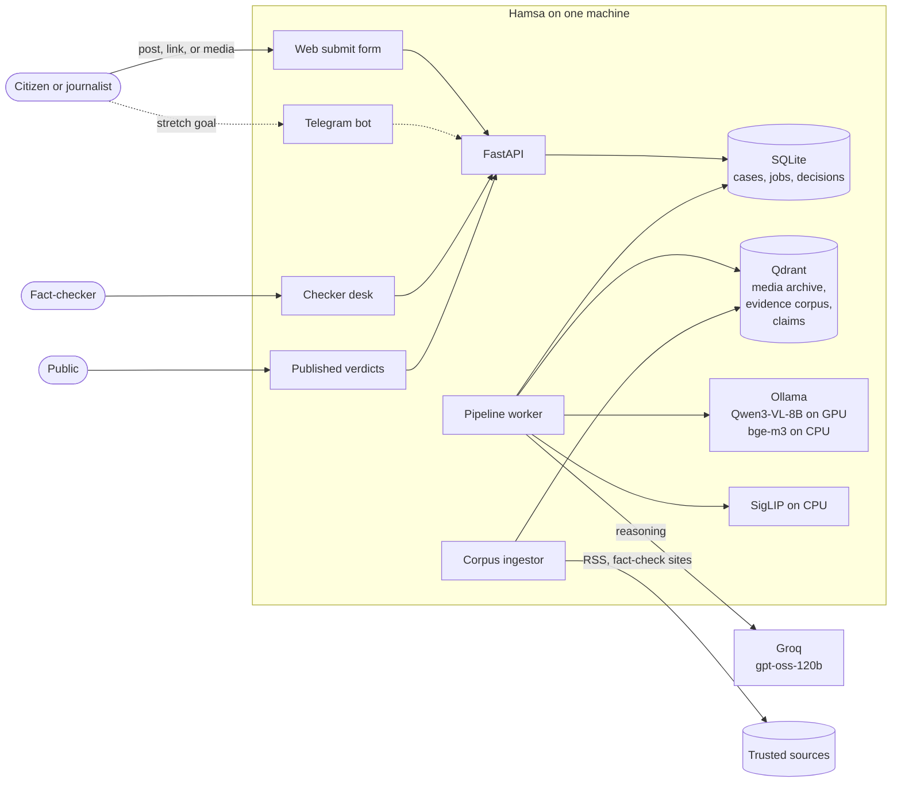
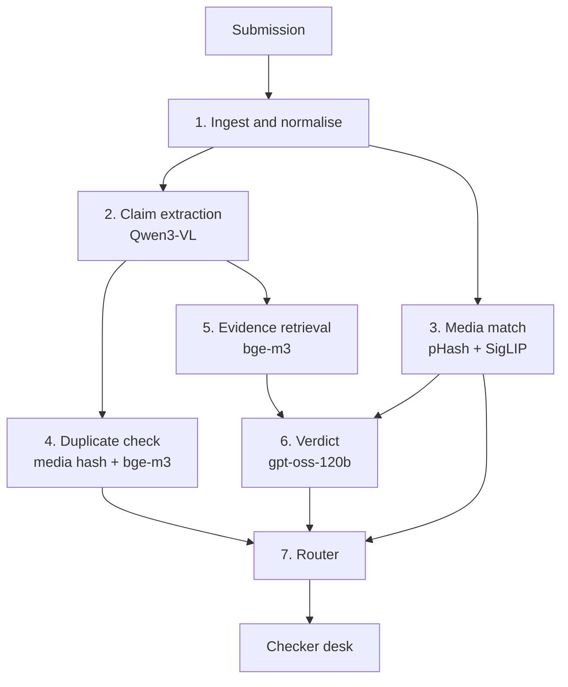
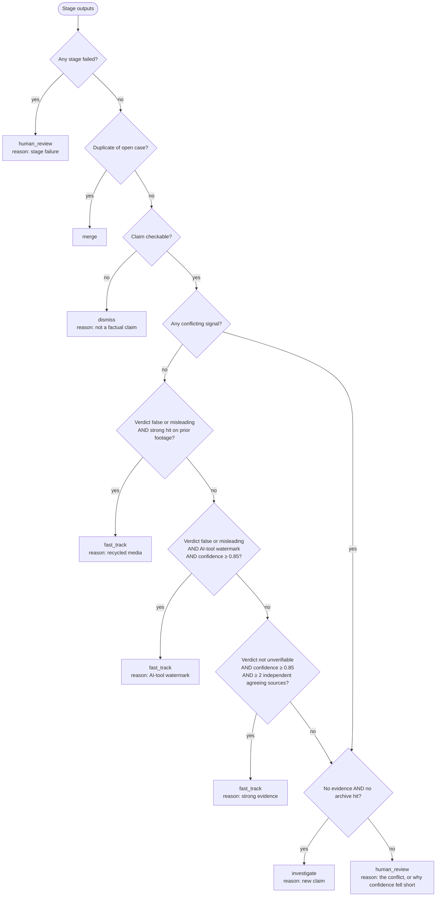
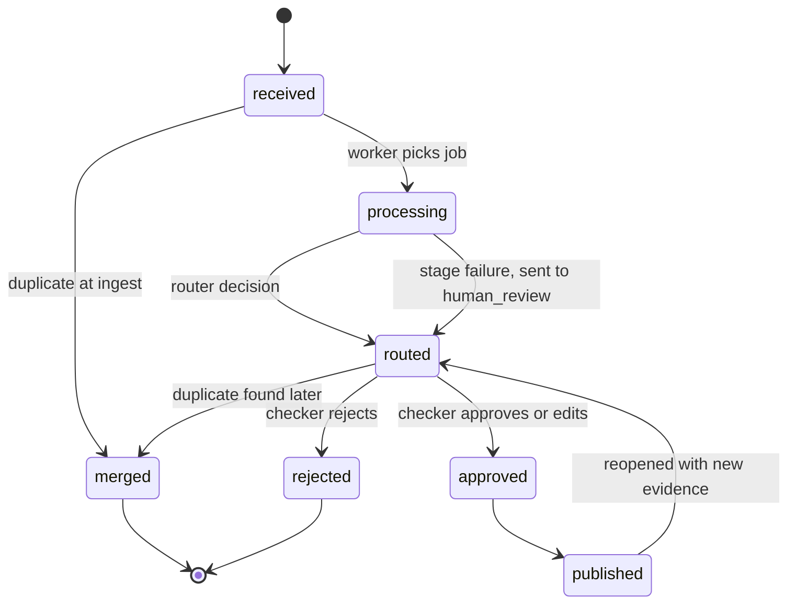
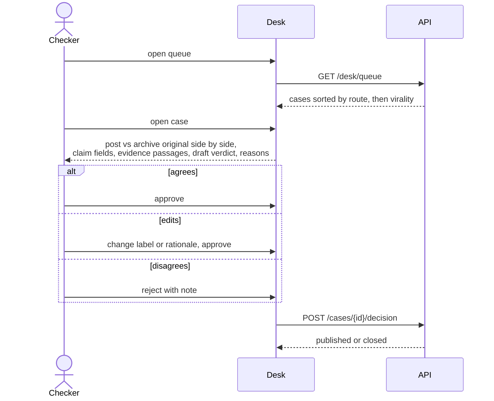

# Architecture

This is the contract for how Hamsa works: what each part takes in, what it returns, how it fails, and what decides where a case goes. Why each choice was made lives in [`docs/adr/`](adr/). Thresholds marked *starting value* are calibrated on the eval tuning split (`h001` to `h040`, see [data collection](data-collection.md)).

## 1. Goals and non-goals

**Goals**
- Cut the time from "suspicious post submitted" to "verdict ready for a human to approve" from hours to minutes.
- Every routing decision is explainable: a checker can see which signal sent a case where.
- Runs on one laptop (8 GB VRAM, 16 GB RAM) with open-weight models only.
- A human approves every published verdict.

**Non-goals**
- Pixel-level detection of AI-generated media ([ADR 0002](adr/0002-no-pixel-level-synthetic-detection.md)).
- Automatic publishing, or any action on a platform (takedowns, replies).
- General-purpose fact-checking. The archive, sources, and prompts target one disaster at a time, configured as an *incident* (for now, the August 2026 floods starting 2026-08-26).

## 2. System context

The API never runs models. It writes a case and a job row, and returns immediately. One worker process takes jobs one at a time ([ADR 0005](adr/0005-sqlite-case-store-and-job-queue.md)). Running one job at a time is also what keeps the vision model alone on the GPU ([ADR 0007](adr/0007-gpu-for-vision-model-only.md)).

## 3. Pipeline

Each stage returns a Pydantic model. Model outputs are requested with a JSON schema (Ollama `format`, Groq structured outputs), then parsed and validated. A response that fails validation is a stage failure (section 6), never a silent default.

### 3.1 Ingest

**In:** `Submission` with `channel` (`web` or `telegram`), optional `text`, optional `url`, and zero or more uploaded files.
**Out:** `NormalisedCase` with the text, the source URL, and a list of `MediaAsset`s (`sha256`, `kind`, `path`, and for video the `keyframes`).

- **URLs:** only allowed platform hosts (Facebook, TikTok, X, YouTube, Instagram) are fetched, with `yt-dlp`. This prevents the server being used to fetch arbitrary internal addresses.
- **Uploads:** at most 100 MB each. The file type is sniffed from its bytes, not its name or extension.
- **Images:** decoded and re-encoded, which strips EXIF metadata including location.
- **Video:** keyframes are taken at scene changes using PyAV, capped at 6 frames per video and scaled to at most 720p.
  - *Measured:* 6 frames cost about 3,200 prompt tokens and take about 4 seconds on the target GPU.
- **Storage:** media goes in `data/cases/<case_id>/`, which is gitignored.

### 3.2 Claim extraction (Qwen3-VL-8B, local)

**In:** the case text plus up to 6 frames.
**Out:** `Claim`

| Field | Type | Used by |
|---|---|---|
| `claim` | str, original language | retrieval, dedup, desk |
| `claim_en` | str | retrieval (cross-lingual), verdict |
| `places` | list of str | retrieval query, verdict |
| `claimed_date` | date or null | "predates the incident" check |
| `numbers` | list of `{value, unit, refers_to}` | verdict (checks death tolls and similar) |
| `visible_text` | list of str | retrieval, verdict |
| `watermarks` | list of str | router (AI-tool marks such as Veo, Sora, Gemini) |
| `handles` | list of str | desk (provenance), dedup |
| `checkable` | bool | router: opinions and prayers are not checkable |

The prompt asks for exactly what is visible or stated, never inferred. Every field may be empty except `claim`. Settings: temperature 0, `num_ctx` 8192.

### 3.3 Media match (pHash + SigLIP, CPU)

**In:** the case's `MediaAsset`s.
**Out:** `MediaMatch` with a list of `ArchiveHit`s (`archive_id`, `frame`, `phash_distance`, `cosine`, `original_context`, `original_date`, `source_url`, `archive_label`).

Implemented in `backend/app/pipeline/media_match.py` ([ADR 0003](adr/0003-two-tier-media-matching.md)). Every frame, both archive and submitted, goes through the same steps:

1. **Canonicalise.** Trim uniform borders, such as letterbox bars and screenshot chrome, which reposts add and pHash is sensitive to.
2. **pHash.** A 64-bit perceptual hash, stored in Qdrant as a +1/-1 vector. For such vectors, dot product = 64 − 2 × Hamming distance, so Qdrant's dot-product search ranks by exact Hamming distance. Submitted frames are also hashed mirrored, and the smaller distance counts.
3. **SigLIP 2** (`google/siglip2-base-patch16-224`, vision tower on the CPU). A normalised embedding, searched by cosine.

Candidates from both searches get both scores. Each archive item keeps its best hit across all submitted frames.

**A hit is strong if pHash distance ≤ 16 or cosine ≥ 0.97.** These are *starting values* from a robustness check on Creative Commons flood photos (`uv run python -m app.eval.media_robustness`, run 2026-10-06):

| Case | pHash distance | Cosine | Strong? |
|---|---|---|---|
| Re-encoded, resized, cropped to 90%, mirrored, black letterbox | 0–8 | 0.97–1.00 | yes |
| Cropped to 70% | 18–22 | 0.97–0.98 | yes, by cosine |
| Caption banner, mirrored plus caption | 0–14 | 0.91–0.96 | yes, by pHash |
| Phone screenshot with status bar | 12–18 | 0.91–0.94 | 1 of 2 |
| **Letterbox with blurred background (TikTok style)** | 26–30 | 0.91–0.95 | **no** |
| *Different photo, same river* | 28–32 | up to **0.947** | no (correct) |

The table shows why SigLIP cannot decide on its own. A different photo of the same river scores *higher* cosine than some genuine reposts, so cosine alone means "same kind of scene", not "same footage". At these thresholds the check matched 17 of 20 edited reposts with 0 false matches out of 5. **Blurred-background letterboxes are a known gap:** a gradient-based trim was tried, and it also cut off caption banners. It is a candidate for future work, judged on eval data.

Each archive item carries a label:
- **`prior`:** footage from before the incident, or from elsewhere.
- **`verified_genuine`:** confirmed footage of this incident.

A hit on `prior` footage is evidence that the post is recycled. A hit on `verified_genuine` footage supports the post being authentic.

### 3.4 Duplicate check

A case is a duplicate of an open case if either:
- **exact media:** any media `sha256` or pHash matches exactly, or
- **same claim:** the bge-m3 cosine between `claim_en` values is 0.92 or more *and* the `places` overlap. *Starting value.*

A duplicate is merged under the existing case, which strengthens its virality signal. It is not processed again.

### 3.5 Evidence retrieval (bge-m3, CPU)

**In:** `Claim`.
**Out:** `Evidence`, a list of up to 8 `Passage`s (`passage_id`, `source`, `source_kind`, `url`, `published_at`, `text`, `score`).

- **Corpus:** a scheduled ingestor reads RSS and article pages from trusted sources (Nepali and English news outlets, government bodies, fact-checkers), splits them into chunks of about 300 tokens, and embeds each chunk.
- **Query:** one query on `claim_en` and one on `claim`, merged by reciprocal rank. This catches matches across Nepali and English.
- **Prior fact-checks:** passages from fact-checkers have `source_kind = fact_check`. A prior fact-check of the same claim is the strongest single evidence signal.
- **Recency:** only passages published on or after the incident start are used, except fact-checks.

### 3.6 Verdict (gpt-oss-120b on Groq, local fallback)

**In:** `Claim`, `MediaMatch`, `Evidence`.
**Out:** `Verdict`

| Field | Type | Rule |
|---|---|---|
| `label` | `false`, `misleading`, `true`, `unverifiable` | same labels as the eval set |
| `confidence` | float from 0 to 1 | model self-report, used only alongside deterministic signals |
| `rationale_en` | str, at most 120 words | shown on the desk |
| `rationale_ne` | str | shown on the published verdict |
| `citations` | list of `{passage_id, stance}`, where stance is `supports` or `refutes` the claim | **every id must exist in the input**, otherwise the output is invalid |
| `model` | str | which model produced it (Groq or fallback) |

The prompt gives the model only the evidence and match results, and instructs `unverifiable` when the evidence does not settle the claim. A citation to a passage that was not provided is treated as a hallucination: the output is rejected and retried once.

### 3.7 Router (deterministic)

The models propose; rules decide ([ADR 0004](adr/0004-deterministic-router.md)). Implemented as a pure function in `backend/app/router/route.py`. The rules are checked in order, the first match wins, and every decision records the reasons that fired it.

**Definitions**
- **Strong hit:** pHash distance of 16 or less, or SigLIP cosine of 0.97 or more (section 3.3). Only `prior` archive hits count as recycled evidence. A `verified_genuine` hit does not, because genuine footage can still carry a false caption.
- **AI-tool watermark:** a reported watermark naming a known generator (Veo, Sora, Gemini, Runway, Kling, and others).
- **Independent agreeing sources:** distinct outlets among the cited passages whose stance matches the verdict (`refutes` for false or misleading, `supports` for true). Two passages from the same outlet count once.
- **Conflicting signal:**
  - a `true` verdict with a strong `prior` hit
  - a `true` verdict with an AI-tool watermark
  - any cited passage whose stance contradicts the verdict

Notes:
- **Thresholds are starting values** (`Thresholds` in the router). Model confidence is not calibrated, so they are tuned to give **fast-track precision of 0.95 or more** on the tuning split, even if that sends more cases to a human. A wrong fast-track is the costliest error Hamsa can make.
- **Recycled-media fast-tracks ignore model confidence,** because the archive match is itself the proof, and the checker sees the original side by side.
- **`unverifiable` is never fast-tracked.**
- **`fast_track` does not mean published.** It means the case goes to the top of the desk with a pre-filled verdict for one-click approval.
- **`dismiss`:** cases are kept and can be reopened from the desk.

## 4. Case lifecycle

Every transition is written as a row in `case_events`, recording the actor (system or checker id), the time, and the reason. This is the audit trail behind every published verdict.

## 5. User journeys

**Submitter.** Pastes a link, text, or media into the web form, then gets a case id and a status page. When the case is published, the status page shows the verdict in Nepali and English with sources.

**Checker.**

Checker edits are stored next to the model's draft. The disagreement rate is a production metric, and the eval set is the offline version of the same measure.

## 6. Failure modes

| Failure | Detection | Response |
|---|---|---|
| Groq rate limit (429) or 5xx | HTTP status | Retry twice, honouring `retry-after`, then fall back to the local model. `Verdict.model` records which model ran. |
| No Groq key | config | Local model for every verdict. |
| Invalid JSON or a schema violation | Pydantic | Retry once with the validation error in the prompt, then mark the stage failed and send the case to `human_review`. |
| Hallucinated citation | id not in the input | Same as invalid JSON. |
| Ollama down or out of memory | connection error or error body | Job retried with backoff, up to 3 attempts, then `human_review` with the reason. |
| Media download fails | yt-dlp exit code | Continue with text only and flag "media unavailable" on the desk. |
| Qdrant down | connection error | Job retried, since every later stage needs it. |
| Worker crash mid-job | job stuck in `running` past its lease | Requeued on worker start. Stages are idempotent per case. |

No failure produces a verdict on its own. The worst outcome is a case on a human's desk with the reason attached.

## 7. Resource budget

Measured on the target machine (RTX 4060 Laptop, 8 GB VRAM, 16 GB RAM) on 2026-10-06.

| Component | Where | Memory | Notes |
|---|---|---|---|
| Qwen3-VL-8B Q4_K_M, ctx 8192 | GPU plus CPU spill | 8.0 GB total (about 29% on CPU) | Load about 11 s; 6 frames about 4 s; output about 20 tokens/s; about 30 s per extraction when warm |
| bge-m3 via Ollama (`num_gpu: 0`) | CPU | about 1.2 GB | 1024-dim; about 3 s cold for a short batch |
| SigLIP base | CPU | about 1 GB | |
| Qdrant | CPU | about 0.5 GB | |
| API, worker, Next.js dev server | CPU | about 2 GB | |

- **The 8B model does not fully fit in 8 GB of VRAM,** so Ollama spills part of it to the CPU. Speed is still acceptable for triage. The worker keeps the model loaded (`keep_alive` 30 minutes) so the 11-second load happens once.
- **Raising `num_ctx` to 16384 pushes 39% onto the CPU,** so it stays at 8192.
- **`qwen3-vl:4b` is the fallback option** if extraction quality is equal on the eval set.
- **The local verdict fallback reuses the vision model** rather than loading a second model, to avoid swapping weights in and out of the GPU.

## 8. Evaluation

Scored on `data/eval/items.csv` by `app/eval/`. Tuning uses `h001` to `h040`, and reported numbers use `h041` onward.

| Metric | What it protects against |
|---|---|
| Recycled-media precision and recall | Missing old footage, or wrongly calling genuine footage old |
| Verdict accuracy and macro-F1 over the four labels | Bad reasoning |
| **Fast-track precision** (target ≥ 0.95) | Confidently wrong verdicts reaching one-click approval |
| Human-review rate | A desk that sends everything to humans saves no time |
| p50 and p95 time per case | The point of the project |

## 9. Security and privacy

- **Desk login:** the desk and decision endpoints need a checker login, with credentials from the environment for the demo. Submit and published-feed endpoints are public and rate-limited per IP.
- **Fetching links:** URL fetching is limited to allowed hosts (section 3.1). Uploads are type-sniffed and size-capped, and are never run or rendered as HTML.
- **Stored data:** EXIF is stripped. Submitter contact details are optional, and Telegram user ids are hashed.
- **Secrets:** come only from the environment (`app/config.py`). `.env` is gitignored, and the pre-commit hooks check for private keys.

## 10. Code map

| Concern | Module |
|---|---|
| Settings | `backend/app/config.py` |
| HTTP API | `backend/app/api/` |
| Ingest, keyframes (`frames.py`), URL fetch | `backend/app/ingest/` |
| Pipeline stages and their models | `backend/app/pipeline/` (`extract.py`, `media_match.py`, `dedup.py`, `retrieve.py`, `verdict.py`) |
| Router | `backend/app/router/route.py` |
| Case store, jobs, events | `backend/app/store/` |
| Eval set and scoring | `backend/app/eval/` |
| Archive build (`uv run python -m app.archive`) | `backend/app/archive.py` |
| Evidence corpus ingestion | `scripts/` |
| Checker desk, submit form, feed | `frontend/` |
