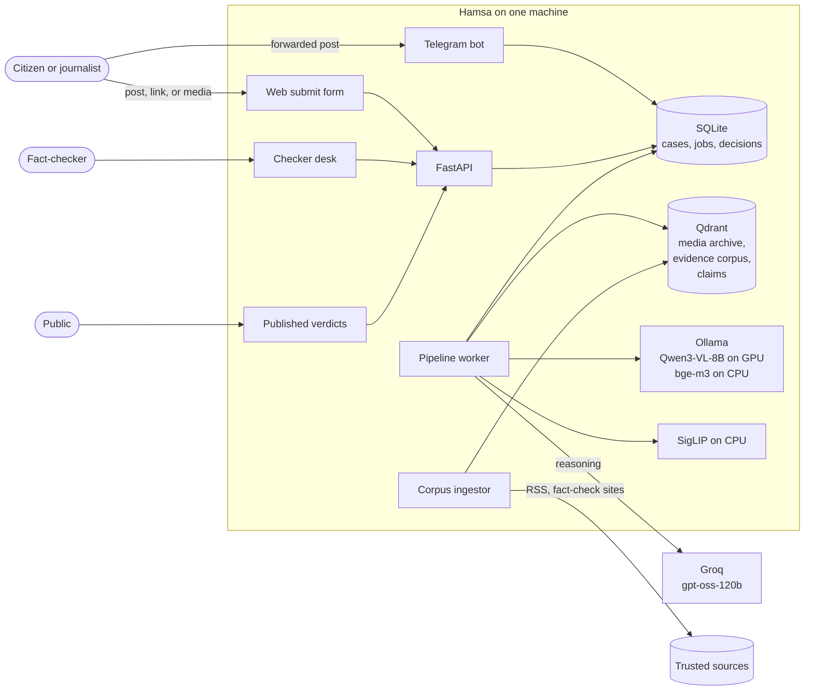
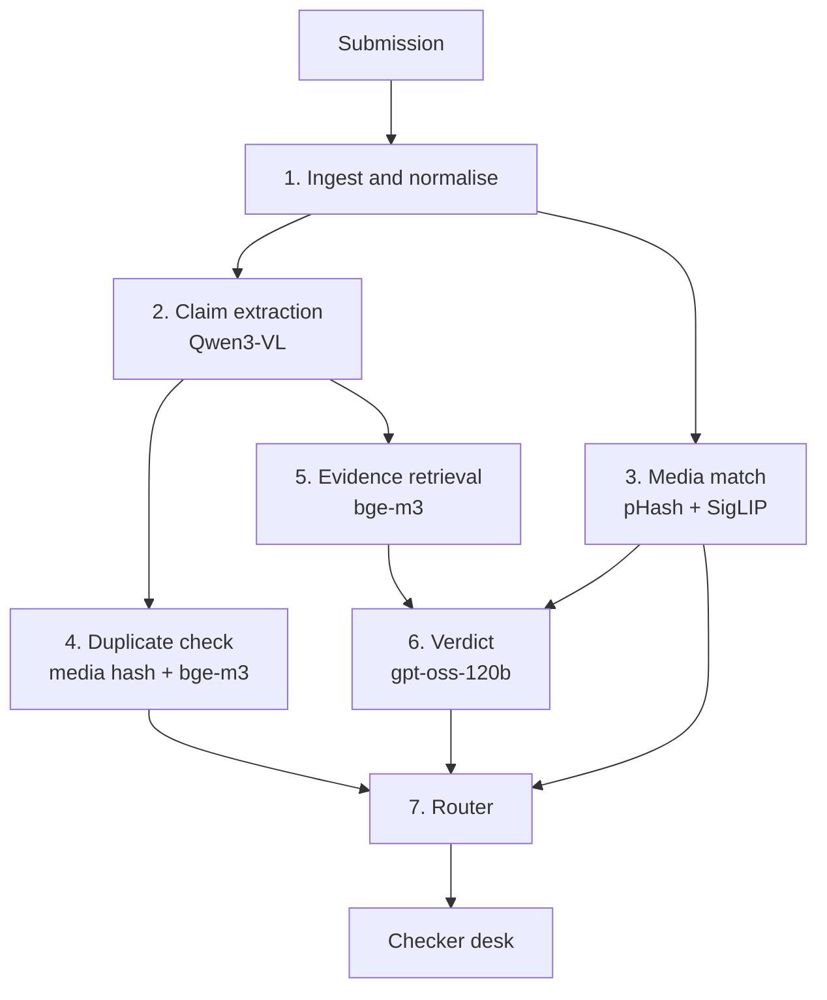
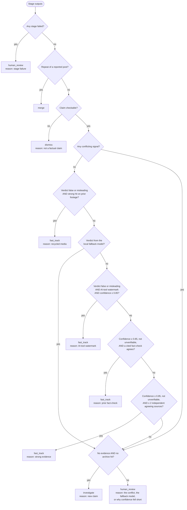
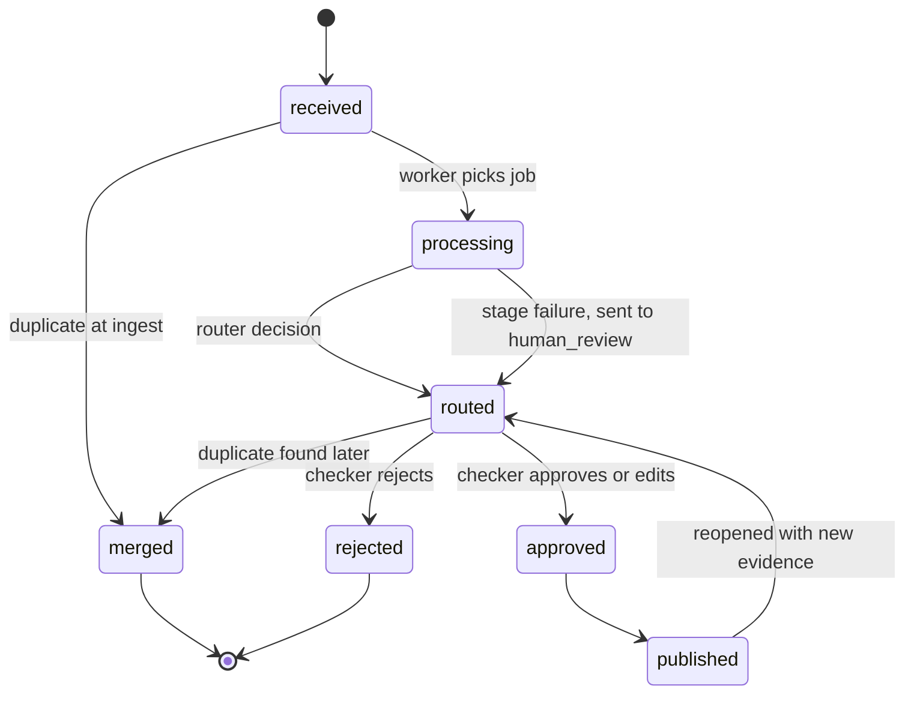
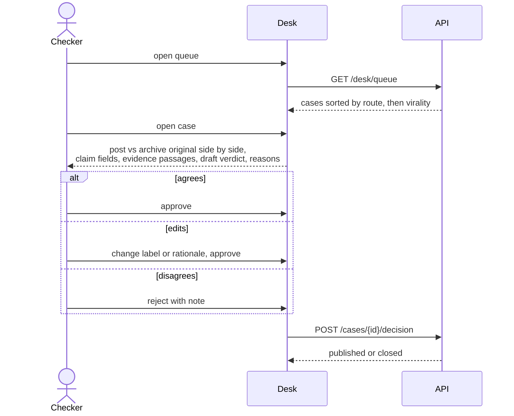

# Architecture

This is the contract for how Hamsa works: what each part takes in, what it returns, how it fails, and what decides where a case goes. Why each choice was made lives in [`docs/adr/`](adr/). Thresholds marked *starting value* are calibrated on the eval tuning split (`h001` to `h040`, see [data collection](data-collection.md)).

## 1. Goals and non-goals

**Goals**
- Cut the time from "suspicious post submitted" to "verdict ready for a human to approve" from hours to minutes.
- Every routing decision is explainable: a checker can see which signal sent a case where.
- Runs on one laptop (8 GB VRAM, 16 GB RAM) with open-weight models only.
- A human approves every published verdict.

**Non-goals**
- Pixel-level detection of AI-generated media ([ADR 0002](adr/0002-no-pixel-level-synthetic-detection.md)).
- Automatic publishing, or any action on a platform (takedowns, replies).
- General-purpose fact-checking. The archive, sources, and prompts target one disaster at a time, configured as an *incident* (for now, the August 2026 floods starting 2026-08-26).

## 2. System context

The API never runs models. It writes a case and a job row, and returns immediately. One worker process takes jobs one at a time ([ADR 0005](adr/0005-sqlite-case-store-and-job-queue.md)). Running one job at a time is also what keeps the vision model alone on the GPU ([ADR 0007](adr/0007-gpu-for-vision-model-only.md)).

## 3. Pipeline

Each stage returns a Pydantic model. Model outputs are requested with a JSON schema (Ollama `format`, Groq structured outputs), then parsed and validated. A response that fails validation is a stage failure (section 6), never a silent default.

### 3.1 Ingest

**In:** `Submission` with `channel` (`web` or `telegram`), optional `text`, optional `url`, and zero or more uploaded files.
**Out:** `NormalisedCase` with the text, the source URL, and a list of `MediaAsset`s (`sha256`, `kind`, `path`, and for video the `keyframes`).

- **URLs:** only allowed platform hosts (Facebook, TikTok, X, YouTube, Instagram) are fetched, with `yt-dlp`. This prevents the server being used to fetch arbitrary internal addresses.
- **Uploads:** at most 100 MB each. The file type is sniffed from its bytes, not its name or extension.
- **Images:** decoded and re-encoded, which strips EXIF metadata including location.
- **Video:** keyframes are taken at scene changes using PyAV, capped at 6 frames per video and scaled to at most 720p.
  - *Measured:* 6 frames cost about 3,200 prompt tokens and take about 4 seconds on the target GPU.
- **Storage:** media goes in `data/cases/<case_id>/`, which is gitignored.

### 3.2 Claim extraction (Qwen3-VL-8B, local)

**In:** the case text plus up to 6 frames.
**Out:** `Claim`

| Field | Type | Used by |
|---|---|---|
| `claim` | str, original language | retrieval, dedup, desk |
| `claim_en` | str | retrieval (cross-lingual), verdict |
| `places` | list of str | retrieval query, verdict |
| `claimed_date` | date or null | "predates the incident" check |
| `claimed_year` | int or null | the same check when only a year is stated, Gregorian or Bikram Sambat |
| `numbers` | list of `{value, unit, refers_to}` | verdict (checks death tolls and similar) |
| `visible_text` | list of str | retrieval, verdict |
| `scene` | str: one sentence on what the frames show | fact-check relevance check, verdict |
| `watermarks` | list of str | router (AI-tool marks such as Veo, Sora, Gemini) |
| `handles` | list of str | desk (provenance), dedup |
| `checkable` | bool | router: opinions and prayers are not checkable |

Implemented in `backend/app/pipeline/extract.py`, with the Ollama client in `backend/app/llm/ollama.py`.

- **What the prompt asks for:** exactly what is stated or visible, never inferred. Every field may be empty except `claim`. Settings: temperature 0, `num_ctx` 8192.
- **The schema sent to Ollama marks every field required.** Constrained decoding lets a model leave out optional fields, and in testing it dropped places, numbers, and handles from a post that had all three. Required fields force an explicit decision for each: an empty list or null.
- **Validation:** the output is validated with Pydantic. On failure the model sees the validation error and gets one retry, then the stage fails and the case goes to `human_review`.
- **Measured on a real viral post** (the Rasuwa/Columbia Glacier video debunked by Nepal Factcheck, 85 s, 6 keyframes): about 18 s.
  - The Nepali claim was kept in Devanagari, with an accurate English translation.
  - The decisive on-screen text ("I've been studying this event on Columbia Glacier for 15 years") was transcribed verbatim.
  - The channel logo was misread by one character ("मुनौलो" for "सुनौलो"). Small Devanagari text in logos is a known OCR weakness.

### 3.3 Media match (pHash + SigLIP, CPU)

**In:** the case's `MediaAsset`s.
**Out:** `MediaMatch` with a list of `ArchiveHit`s (`archive_id`, `frame`, `phash_distance`, `cosine`, `original_context`, `original_date`, `source_url`, `archive_label`).

Implemented in `backend/app/pipeline/media_match.py` ([ADR 0003](adr/0003-two-tier-media-matching.md)). Every frame, both archive and submitted, goes through the same steps:

1. **Canonicalise.** Trim uniform borders, such as letterbox bars and screenshot chrome, which reposts add and pHash is sensitive to.
2. **pHash.** A 64-bit perceptual hash, stored in Qdrant as a +1/-1 vector. For such vectors, dot product = 64 − 2 × Hamming distance, so Qdrant's dot-product search ranks by exact Hamming distance. Submitted frames are also hashed mirrored, and the smaller distance counts.
3. **SigLIP 2** (`google/siglip2-base-patch16-224`, vision tower on the CPU). A normalised embedding, searched by cosine.
4. **ORB keypoints** (1000 per frame at 640 px, stored in the payload). Every candidate from either search is verified with ORB plus RANSAC: the inliers are keypoint matches consistent with one shift, scale and rotation, which survive crops, blurred bars, captions and screenshots ([ADR 0009](adr/0009-orb-geometric-verification.md)).

Candidates from both searches get both scores. Each archive item keeps its best hit across all submitted frames.

**A hit is strong if pHash distance ≤ 10, cosine ≥ 0.97, or at least 30 ORB inliers.** On the eval set the reposts ORB found scored 68 to 438 inliers and unrelated clips at most 23, which took recycled recall from 2 to 6 of 9. The pHash and cosine limits started at 16 and 0.97 from a robustness check on Creative Commons flood photos (`uv run python -m app.eval.media_robustness`, run 2026-10-06, table below with the current result):

| Case | pHash distance | Cosine | Strong? |
|---|---|---|---|
| Re-encoded, resized, cropped to 90%, mirrored, black letterbox | 0–8 | 0.97–1.00 | yes |
| Cropped to 70% | 18–22 | 0.97–0.98 | yes, by cosine |
| Caption banner, mirrored plus caption | 0–14 | 0.91–0.96 | 2 of 4 (the two at 14 miss) |
| Phone screenshot with status bar | 12–18 | 0.91–0.94 | no |
| **Letterbox with blurred background (TikTok style)** | 26–30 | 0.91–0.95 | **no** |
| *Different photo, same river* | 28–32 | up to **0.947** | no (correct) |

The table shows why SigLIP cannot decide on its own. A different photo of the same river scores *higher* cosine than some genuine reposts, so cosine alone means "same kind of scene", not "same footage". At pHash ≤ 16 the check matched 17 of 20 edited reposts with 0 false matches out of 5. **The first eval run on real video (2026-10-11) moved the limit to 10:** unrelated news clips matched eval posts from pHash 12 upward, mostly on end cards and logo frames, while the true matches scored 4 and 10. At 10 the photo check matches 14 of 20 edits, still with 0 false matches; a missed repost goes to a human, a false one would be fast-tracked. **Blurred-background letterboxes are a known gap,** and a common one: the first real viral post tested (Rasuwa, above) uses exactly this format. A gradient-based trim was tried, and it also cut off caption banners. Fixing this is the top media-match priority once the eval set has real examples.

Each archive item carries a label:
- **`prior`:** footage from before the incident, or from elsewhere.
- **`verified_genuine`:** confirmed footage of this incident.

A hit on `prior` footage is evidence that the post is recycled. A hit on `verified_genuine` footage supports the post being authentic, until that footage is old: genuine clips of one disaster are the most likely to be reposted as the next one (section 3.7).

### 3.4 Duplicate check

**The same post** (`same_post` in `backend/app/store/cases.py`, checked by the worker before any model runs, so a repeat costs no model time) is a repeat of an earlier report, open *or decided*, if any of these match:
- **link:** the link as sent, normalised (`normalize_url`: mobile hosts, `twitter.com` as `x.com`, `youtu.be`, tracking parameters such as `mibextid`, `si`, `fbclid`, `utm_*`). Checked before the download, so a forwarded link is not fetched again.
- **post id:** the platform's own id from yt-dlp (`Youtube:EmM79Xzvbg0`, kept in the `post_ids` table), which survives share links and redirects.
- **exact media:** any file's `sha256`. Against a decided report only when the new post has the same words or none: a new caption can make genuine footage a false claim, so that copy is checked afresh, and the archive tells the verdict what the checker decided about the footage.

A repeat of a decided report answers the sender at once: Telegram sends that verdict, and the web report shows it. Only earlier cases count, so a first report never merges into its own later copy.

A later case is also a duplicate of an earlier open case if it makes **the same claim**: after extraction, the bge-m3 cosine between `claim_en` values is 0.92 or more *and* a place overlaps, where one place name containing the other counts ("बुटवल" and "बुटवल उपमहानगरपालिका"). `claim_duplicate` in `backend/app/pipeline/duplicate.py`. *Starting value.*

A duplicate is merged under the existing case, which strengthens its virality signal. It is not processed further. Re-encoded copies (different bytes) are not caught here; they still reach media match, where the archive finds them if the footage is known. Checked end to end on 2026-10-12: an identical video merged by media, the same caption without the video merged by claim.

### 3.5 Evidence retrieval (bge-m3, CPU)

**In:** `Claim`.
**Out:** `Evidence`, a list of up to 8 `Passage`s (`passage_id`, `source`, `source_kind`, `url`, `published_at`, `text`, `score`).

Implemented in `backend/app/pipeline/retrieve.py`. The corpus is built once by `uv run python -m app.corpus fetch` and then `index`, and kept current by `uv run python -m app.corpus watch`, which every 15 minutes fetches recent articles from every source and indexes only the ones not seen before (`refresh` in `backend/app/corpus/__main__.py`).

- **Sources:**
  - WordPress REST APIs, which return clean full article text: Onlinekhabar (Nepali and English), Nepalnews, and Nepal Factcheck.
  - RSS feeds, which list only the latest items with a headline and lead: Techpana, Ratopati, and Setopati. Techpana items whose link contains "fact-check" are stored as fact-checks.
  - News is limited to disaster terms of any kind: बाढी, पहिरो, डुबान, हिमताल, भूकम्प, डढेलो, आगलागी, चट्याङ; flood, landslide, GLOF, inundation, earthquake, avalanche, wildfire.
  - Fact-checks are fetched from all time, because recycled clips are often debunked years earlier.
  - **Fact-checks published abroad** (AFP, Boom, Alt News and others, which debunked 22 of the 33 eval posts labelled from a fact-check) are searched per case through Google's ClaimReview index when `FACT_CHECK_API_KEY` is set, with the English claim and the on-screen text. Up to 2 reviews not already in the corpus go first among the 8 passages ([ADR 0012](adr/0012-search-fact-checks-published-abroad.md), `backend/app/pipeline/claim_reviews.py`). A failed search leaves corpus evidence only. Since a keyword match is about the same disaster, not the same post (one Alt News roundup was cited against every flood post), gpt-oss-20b first judges each of the top 4 reviews against the post with the review's opening text, and drops any it cannot judge (`covering`; measured 2026-10-21: kept 5 of 7 right reviews, rejected the unrelated ones). Fact-checks retrieved from the corpus pass the same check (`vetted`): a corpus check of the Trishuli 3B project had refuted a genuine 3A tunnel-rescue post (live L31). It first names the footage the fact-check examined, then says whether it fits the post's `scene`; a review describing other footage never covers a post with media. Without this, a genuine Sky News report ("Nepal and Tibet five days ago") was matched to two AFP checks of other videos and drafted false (2026-10-22). Reviews that describe no footage (a cause claim, an article that refused the fetch) still count on the claim alone. The index matches keywords, so the claim's first 12, 8 and 5 words are searched separately and the results fused by rank. **Measured 2026-10-20** (`python -m app.eval.review_recall`, 19 eval posts with a fact-check and an extracted claim): the right fact-check reached the evidence for 4, all 4 of those debunked abroad that the index holds (AFP twice, Boom, Alt News); whole-sentence queries had found 1. Vague posts ("This Nepal–Tibet flood video is real") draw unrelated reviews.
  - **The open web**, per case, through a self-hosted SearXNG news search when `SEARXNG_URL` is set (`backend/app/pipeline/web_search.py`). The top 6 results are fetched; a page counts only if it is dated inside the news window (figures change daily, so undated pages are dropped) and its best chunk scores bge-m3 cosine 0.6 or more against the claim (measured 2026-10-22: on-topic pages 0.67–0.76, off-topic 0.25–0.37). Up to 2 take the last evidence slots as `source_kind = web`. Web pages are untrusted: the verdict model is told to prefer a trusted passage, and the router never counts them as independent sources. On "403 tourists missing" it found "596 foreign tourists missing" (Business Insider, 28 Aug), the same-group figure the corpus lacked.
  - Other outlets block automated access or publish malformed feeds; any outlet with a WordPress API or an RSS feed is added with one line in `backend/app/corpus/fetch.py`.
- **Corpus as of 2026-10-06:** 5,365 articles, 15,065 passages.
- **Chunking:** paragraphs packed into chunks of at most 1,200 characters, splitting long paragraphs at sentence ends (`।` and `.`). The article title is prepended to each chunk before embedding.
- **Indexing** is an offline batch job on the GPU, with 4 concurrent requests: about 19 passages/s, so roughly 14 minutes for the full corpus. The CPU would take about 2 hours at 2.2 passages/s. CPU and GPU embeddings are identical (cosine 1.0), so per-case queries run on the CPU against a GPU-built index.
- **Queries:** three queries, merged with reciprocal rank fusion (k = 60): the original-language claim, the English claim, and the on-screen text. On-screen text often names the true origin, such as "Columbia Glacier".
- **Recency:** news counts from 30 days before the date the claim is about (its stated date, else the post's upload date, else the day it was sent) until 14 days after it when the claim or the post is dated, since reports follow an event but later news is about later events. Fact-checks of any date count. No deployment is tied to one disaster (`news_since` in `backend/app/pipeline/retrieve.py`).
- **Diversity:** at most 2 passages per article and 8 in total, so the verdict sees independent sources.
- **Prior fact-checks:** fact-checker passages have `source_kind = fact_check`. A prior fact-check of the same claim is the strongest single evidence signal.

**Measured on 2026-10-06** (0.3 s per claim warm, 2 s cold):

| Claim | Outcome |
|---|---|
| Rasuwa GLOF video (debunked by Nepal Factcheck) | The debunk ranks 3rd, alongside news on the real cause (a Langtang rockfall) |
| "Butwal flooding" video (debunked by Nepal Factcheck) | The debunk ranks 1st |
| "24 rescued from the Chilime tunnel" (debunked by Techpana, not in the corpus) | News reporting people still trapped, which is the evidence that refutes it |
| "Melamchi bazaar swept away, 50 missing" (invented) | No Melamchi evidence, only real Rasuwa coverage, so the verdict should be `unverifiable` |

**Evaluation caveat:** the corpus contains published fact-checks, including those for eval items. That is the realistic case, since Hamsa's main job is catching claims that are already debunked as they resurface. But it flatters verdict accuracy, so the eval also reports a run with fact-check passages excluded; that run also turns the ClaimReview search off.

### 3.6 Verdict (gpt-oss-120b on Groq, local fallback)

**In:** `Claim`, `MediaMatch`, `Evidence`.
**Out:** `Verdict`

| Field | Type | Rule |
|---|---|---|
| `label` | `false`, `misleading`, `true`, `unverifiable` | same labels as the eval set |
| `confidence` | float from 0 to 1 | model self-report, used only alongside deterministic signals |
| `rationale_en` | str, at most 120 words | shown on the desk |
| `rationale_ne` | str | shown on the published verdict |
| `citations` | at most 3 of `{passage_id, stance}`, where stance is `supports` or `refutes` the claim | **every id must exist in the input**, otherwise the output is invalid |
| `media_finding` | `shows_claim`, `elsewhere`, `ai_generated`, `not_established`, `no_media` | router: a refuting label needs a contradicting finding |
| `event_finding` | `confirmed`, `contradicted`, `not_found` | same |
| `number_finding` | `consistent`, `contradicted`, `not_established`, `none_claimed` | same; `contradicted` needs the post's date |
| `model` | str | which model produced it (Groq or fallback) |
| `fallback` | bool | true when the local model judged because Groq was unavailable |
| `nepali_issue` | str or null | why the Nepali rationale may not say what the English says, or that it could not be checked; null when gpt-oss-20b found it faithful |

Implemented in `backend/app/pipeline/verdict.py`, with clients in `backend/app/llm/groq.py` and `backend/app/llm/ollama.py`.

- **Findings before the label.** The model records what it found about the media, the event, and the figures, then picks the label. A claim nothing supports was drafted `false` at 0.92 ("403 tourists missing": no report counted tourists), so the router checks the label against the findings. Figures are judged against reports from around the post's date, since counts change daily.
- **Evidence only.** The prompt gives the model the claim, the post's date when known, the strong archive matches only (a weak one was read as evidence), and the evidence passages with their headlines. It instructs `unverifiable` whenever the passages do not address this specific claim. The post and the passages are marked as data, so instructions inside them are ignored.
- **The implicit media claim.** A post with images or video claims that the media shows the event. The prompt tells the model to check that claim first: on-screen text naming another place, a fact-check of the same footage, or an archive match. On the real Rasuwa post this changed the verdict from "misleading, the cause is disputed" to "false, the video is from Columbia Glacier".
- **Headlines.** Fact-check headlines usually state the verdict, so every passage is shown with its title.
- **Citations cannot point at missing passages.** Passages are shown as `E1`..`E8`, and the JSON schema allows only those labels in `citations`, so under constrained decoding (Groq strict mode, Ollama `format`) an unseen passage cannot be cited. A post-parse check guards the same rule, plus the 120-word rationale limit; a violation gets one retry with the error shown.
- **Fallback.** Groq first; on `ReasonerUnavailable` or invalid output twice, the local vision model drafts and `fallback` is set. The fallback is measurably weaker: on an invented claim it answered `false` at 0.98 because no passage mentioned the claim, where Groq answered `unverifiable`. So the router never fast-tracks a fallback verdict on model judgement alone (section 3.7).
- **Nepali check.** The model writes both rationales at once and sometimes flips a fact in the Nepali: a published test verdict said "the video is not from Surat" beside an English "it is from Surat". gpt-oss-20b (its own Groq quota) compares the two; any problem, or a failed check, is a router conflict, so a checker reads the Nepali before it is published. On 2026-10-12 it caught both planted flips and 3 real problems in 28 eval verdicts, with one borderline flag (a place name left out).
- **Cost.** About 2,900 prompt tokens and 400–600 completion tokens per verdict. Groq's free tier allows 8,000 tokens/min, so about two verdicts per minute.
- **Variance.** Repeated runs at temperature 0 still vary: the Rasuwa post came back `false` 0.90, `misleading` 0.78, and `false` 0.92. All three were correct refuting labels citing the debunk, but only the last cleared the fast-track threshold. The eval set measures this variance; the router's thresholds absorb it.

### 3.7 Router (deterministic)

The models propose; rules decide ([ADR 0004](adr/0004-deterministic-router.md)). Implemented as a pure function in `backend/app/router/route.py`. The rules are checked in order, the first match wins, and every decision records the reasons that fired it.

**Definitions**
- **Strong hit:** pHash distance of 10 or less, SigLIP cosine of 0.97 or more, or at least 30 ORB inliers (section 3.3). Recycled evidence is a strong hit on `prior` footage, or on `verified_genuine` footage dated more than 30 days (`same_event_days`) before the post. The post's date is the date it claims, else the date it was posted or submitted. A recent `verified_genuine` hit does not count, because genuine footage can still carry a false caption, and a post that names its event's own date ("the 2026 Rasuwa flood") is not recycled.
- **AI-tool watermark:** a reported watermark naming a known generator (Veo, Sora, Gemini, Runway, Kling, and others).
- **Independent agreeing sources:** distinct publishers among the cited passages whose stance matches the verdict (`refutes` for false or misleading, `supports` for true). Two passages from the same publisher count once, and so do two editions of one outlet: Onlinekhabar's Nepali and English sites were first counted as two sources, which would have let the fallback model's wrong verdict fast-track.
- **Prior fact-check:** a cited passage from a fact-checker whose stance matches the verdict. Catching already-debunked claims as they resurface is Hamsa's core job, so one agreeing fact-check is enough for a text post, with confidence and no conflict. **For a post with photos or video it also needs a strong frame match**, whatever the verdict says about the words: the matched check is often the only thing "contradicting" them (live L29: BOOM's check of an AI copy of the real police rescue). The independent-sources rule needs the frame match **when the label rests on the footage** (a true verdict, or footage from elsewhere or AI-made while the post's words and figures stand): a fact-check is about a claim, not provably about this file. On the eval's tune split every such fast-track was right (10 of 10), because every post there was a debunked fake; on live posts (2026-10-22), checks of an AI copy of a real rescue and of other videos landed on genuine BBC, Sky News and CNN footage, 4 of 8 times. Without the frame match the case goes to a human with the fact-check cited (tune split: 7 of 7 fast-tracks right, 82% to a human).
- **Fallback verdicts** never fast-track on model judgement alone (watermark, fact-check, or evidence rules). Only the deterministic recycled-media rule can fast-track them.
- **Conflicting signal:**
  - a `true` verdict with a strong `prior` hit
  - a `true` verdict with an AI-tool watermark
  - any cited passage whose stance contradicts the verdict
  - a `true` verdict whose `media_finding` is `elsewhere` or `ai_generated`, or `not_established`: a real event does not vouch for unidentified footage
  - a `false` or `misleading` verdict with no contradicting finding, strong `prior` hit, or watermark: absence of evidence is not a refutation
  - a `contradicted` figure when neither the post nor its claim gives a date

Notes:
- **Thresholds are starting values** (`Thresholds` in the router). Model confidence is not calibrated, so they are tuned to give **fast-track precision of 0.95 or more** on the tuning split, even if that sends more cases to a human. A wrong fast-track is the costliest error Hamsa can make.
- **Footage a checker published:** a strong frame match to a case's archived keyframes (`case-<id>-<n>`, written by `teach()` in `backend/app/learn.py`), a verdict with the label the checker published, no conflict, and no fallback model fast-tracks with "same footage published as <label> on Hamsa (<case>)". A misdated repost of genuine footage is a conflict under the date rules, so it never borrows the earlier "true".
- **Recycled-media fast-tracks ignore model confidence,** because the archive match is itself the proof, and the checker sees the original side by side.
- **`unverifiable` is never fast-tracked.**
- **`fast_track` does not mean published.** It means the case goes to the top of the desk with a pre-filled verdict for one-click approval.
- **`dismiss`:** cases are kept and can be reopened from the desk.

## 4. Case lifecycle

Every transition is written as a row in `case_events`, recording the actor (system or checker name), the time, and the reason. This is the audit trail behind every published verdict.

Implemented in `backend/app/store/`.
- **Claiming a job** is one atomic `UPDATE … RETURNING` that takes the oldest due job, or one whose 10-minute lease expired (a dead worker's).
- **Retries:** transient stage failures (Ollama or Qdrant unreachable, HTTP 5xx) requeue the job with backoff (30 s, then 2 min, at most 3 attempts) before the case goes to a human.
- **Pipeline bugs** route the case to a human with the error, rather than looping or losing it.
- **Storage:** SQLite runs in WAL mode, so the API reads while the worker writes. Times are stored as UTC and always load time-zone aware.

## 5. User journeys

**Submitter.** Pastes a link, text, or media into the web form, then gets a case id and a status page. When the case is published, the status page shows the verdict in Nepali and English with sources.

**Telegram submitter.** Forwards a post, or sends its link, photo or video, to the bot (`backend/app/telegram.py`, long polling, so no public address is needed). The bot writes the case like the API does (`Channel.TELEGRAM`) and replies with the report link. A `telegram_reports` row remembers the chat; each poll the bot sends news it has not sent yet: the published verdict with sources, a rejection, a merge into an earlier report (and later that report's verdict), or a request for the file when the link could not be opened. Only direct messages count, so a group cannot flood the desk. Files over 20 MB are refused by the Bot API, so the bot asks for the link instead.

**Checker.**

Checker edits are stored next to the model's draft. The disagreement rate is a production metric, and the eval set is the offline version of the same measure.

## 6. Failure modes

| Failure | Detection | Response |
|---|---|---|
| Groq rate limit (429) or 5xx | HTTP status | 429: wait for `retry-after` if it is 30 s or less (the free tier typically says about 7 s), up to 3 attempts. 5xx: retry with backoff. Then fall back to the local model, with `Verdict.fallback` set. |
| No Groq key | config | Local model for every verdict. |
| Invalid JSON or a schema violation | Pydantic | Retry once with the validation error in the prompt, then mark the stage failed and send the case to `human_review`. |
| Hallucinated citation | id not in the input | Same as invalid JSON. |
| Ollama down or out of memory | connection error or error body | Job retried with backoff, up to 3 attempts, then `human_review` with the reason. |
| Media download fails | yt-dlp exit code | Continue with text only and flag "media unavailable" on the desk. |
| Qdrant down | connection error | Job retried, since every later stage needs it. |
| Worker crash mid-job | job still `running` past its 10-minute lease | The next claim takes it again (attempts counted). Stages are idempotent per case. |

No failure produces a verdict on its own. The worst outcome is a case on a human's desk with the reason attached.

## 7. Resource budget

Measured on the target machine (RTX 4060 Laptop, 8 GB VRAM, 16 GB RAM) on 2026-10-06.

| Component | Where | Memory | Notes |
|---|---|---|---|
| Qwen3-VL-8B Q4_K_M, ctx 8192 | GPU plus CPU spill | 8.0 GB total (about 29% on CPU) | Load about 11 s; 6 frames about 4 s; output about 20 tokens/s; about 30 s per extraction when warm |
| bge-m3 via Ollama (`num_gpu: 0`) | CPU | about 1.2 GB | 1024-dim; about 3 s cold for a short batch |
| SigLIP base | CPU | about 1 GB | |
| Qdrant | CPU | about 0.5 GB | |
| API, worker, Next.js dev server | CPU | about 2 GB | |

- **The 8B model does not fully fit in 8 GB of VRAM,** so Ollama spills part of it to the CPU. Speed is still acceptable for triage. The worker keeps the model loaded (`keep_alive` 30 minutes) so the 11-second load happens once.
- **Raising `num_ctx` to 16384 pushes 39% onto the CPU,** so it stays at 8192.
- **`qwen3-vl:4b` is the fallback option** if extraction quality is equal on the eval set.
- **The local verdict fallback reuses the vision model** rather than loading a second model, to avoid swapping weights in and out of the GPU.

**End to end**, the real Rasuwa post (85 s video, Groq verdict, models warm) takes about **17.5 s**: ingest 0.9, extract 12.3, media match 1.2, retrieve 0.5, verdict 2.6. A text-only post takes about 10 s. Run it with `uv run python -m app.pipeline <media> --text "<post>"`.

## 8. Evaluation

Scored on `data/eval/items.csv` by `app/eval/`. Tuning uses `h001` to `h040`, and reported numbers use `h041` onward.

| Metric | What it protects against |
|---|---|
| Recycled-media precision and recall | Missing old footage, or wrongly calling genuine footage old |
| Verdict accuracy and macro-F1 over the four labels | Bad reasoning |
| **Fast-track precision** (target ≥ 0.95) | Confidently wrong verdicts reaching one-click approval |
| Human-review rate | A desk that sends everything to humans saves no time |
| p50 and p95 time per case | The point of the project |

## 9. Security and privacy

- **Desk access:** every `/desk` endpoint needs `Authorization: Bearer $DESK_TOKEN`, compared in constant time. The desk is disabled (503) while no token is set. Decisions record the checker's name in the audit trail.
- **Public endpoints never show model drafts.** A submitter sees the case status, and the verdict only after a checker publishes it.
- **Submissions:** at most 10 per minute per client IP (in-memory sliding window; one API process). At most 4 files of 100 MB each, typed by their bytes (JPEG, PNG, WebP, MP4/MOV, WebM/MKV), never by name or declared type, and stored under a content-hash name. Media is served back only by a stored name, which also blocks path traversal.
- **Links:** stored as given and validated as URLs. Fetching them (planned, with `yt-dlp`) will be limited to allowed platform hosts, so the server cannot be used to fetch internal addresses.
- **Stored data:** EXIF is dropped when frames are decoded. No submitter contact details are collected.
- **Secrets:** come only from the environment (`app/config.py`). `.env` is gitignored, and the pre-commit hooks check for private keys.

## 10. Code map

| Concern | Module |
|---|---|
| Settings | `backend/app/config.py` |
| HTTP API (`uv run uvicorn --factory app.api.main:default_app`) | `backend/app/api/` |
| Ingest, keyframes (`frames.py`), URL fetch | `backend/app/ingest/` |
| Pipeline stages and their models | `backend/app/pipeline/` (`extract.py`, `media_match.py`, `dedup.py`, `retrieve.py`, `verdict.py`) |
| Router | `backend/app/router/route.py` |
| Case store, jobs, events | `backend/app/store/` |
| Worker (`uv run python -m app.worker`) | `backend/app/worker.py` |
| Pipeline runner (`uv run python -m app.pipeline`) | `backend/app/pipeline/run.py` |
| Eval set and scoring | `backend/app/eval/` |
| Archive build (`uv run python -m app.archive`) | `backend/app/archive.py` |
| Evidence corpus ingestion | `scripts/` |
| Checker desk (Next.js; queue, case workspace, decisions) | `frontend/src/` |
